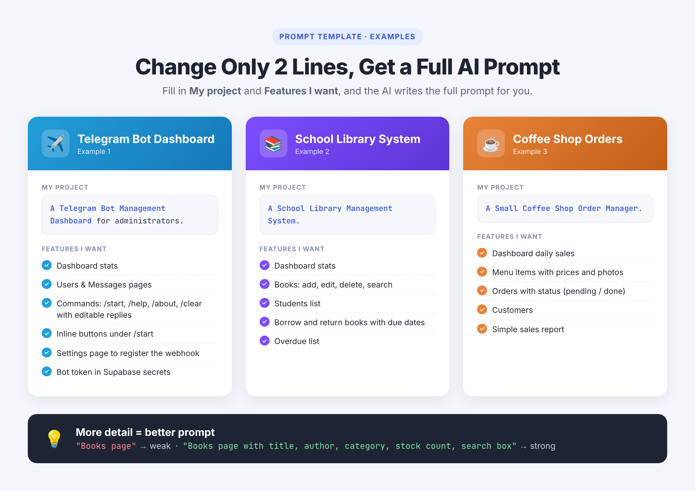

```text
My project: [describe your app here, e.g. "A Telegram Bot Management Dashboard"]

Features I want: [list your pages/features]

You are an expert prompt engineer and full-stack teacher.
Write ONE complete, detailed prompt that I can paste into Google AI Studio
(Build mode) to generate my working web app.

Make the prompt detailed and specific: list every page, every database table
with columns, every Edge Function, and every setup step. Do not be vague.

The prompt you write must include these sections:

1. TECH STACK
   React + TypeScript + Tailwind CSS (Vite), Supabase (PostgreSQL, Auth,
   Edge Functions with Deno), native fetch for any external API.
   No Node.js/Express backend. No Gemini or any paid AI service.

2. OUTPUT RULES
   Write all code ONLY into project files, never paste code or SQL in the chat.
   SQL goes in supabase/migrations/001_init.sql, the setup guide goes in SETUP.md,
   and the chat reply is only a short list of files.

3. FRONTEND CONFIG
   .env with VITE_SUPABASE_URL and VITE_SUPABASE_ANON_KEY (import.meta.env),
   plus .env.example and .gitignore. Show a friendly "Supabase is not configured"
   screen if values are missing.

4. AUTHENTICATION
   Supabase Auth login/logout, no public sign-up page. Only users in an
   "admins" table can access the dashboard. Protect all pages.

5. PAGES
   Each page and exactly what it shows or does. Clean, modern, responsive
   design with sidebar navigation. Use React Router BrowserRouter.

6. DATABASE
   Every table with columns and types, default/sample data where needed,
   indexes, an is_admin() function, and Row Level Security on all tables.

7. EDGE FUNCTIONS (only if needed)
   Use them for anything secret or external (APIs, bots, webhooks).
   Include CORS + OPTIONS handling, admin authorization checks, and secrets
   stored in Supabase Edge Function Secrets. Webhooks from outside services
   must disable JWT verification and use their own secret check.

8. SECURITY
   Never put secret keys (API tokens, service-role key) in the frontend or .env.
   Only the anon/publishable key is allowed in the frontend.

9. CLOUDFLARE WORKERS DEPLOY
   wrangler.jsonc with assets directory ./dist and
   not_found_handling "single-page-application", no Worker script.
   Deploy with "npm run build && npx wrangler deploy".
   If deploying from Git, VITE_ variables must be BUILD variables.
   Set Supabase Auth Site URL to the workers.dev URL.

10. SETUP.md
    Beginner step-by-step guide: create Supabase project, fill .env, run SQL,
    create admin user and insert into admins table, set secrets, deploy
    Edge Functions, run locally (npm install, npm run dev), deploy to
    Cloudflare Workers, and test every feature.
    Add a "Common Errors and Fixes" section for this project.

Keep it simple for a beginner and a 3-hour workshop.
Real working functionality, no mock data.
Reply with only the final prompt inside one code block.
```

---

## Full AI Studio prompt: Telegram Bot Dashboard

Paste this directly into **Google AI Studio → Build**.

```text
Build a simple Telegram Bot Management Dashboard for a 3-hour beginner student workshop.
Generate real working code, not mock data. Keep the code simple and well commented.

IMPORTANT OUTPUT RULES
- Write all code ONLY into project files. Do NOT paste code or SQL in the chat.
- Your chat reply must be short: a list of created files + 3-line summary.
- Put the SQL in supabase/migrations/001_init.sql.
- Put the setup guide in SETUP.md (not in the chat).

TECHNOLOGY STACK
- ReactJS + TypeScript + Tailwind CSS (frontend only), Vite
- Supabase PostgreSQL, Supabase Auth, Supabase Edge Functions (Deno)
- Telegram Bot API using native fetch
- Frontend hosting: Cloudflare Workers (static assets)
Rules:
- Do NOT create a Node.js/Express backend.
- Do NOT use Gemini API, @google/genai, or any AI/paid service. Remove any AI code.
- Use @supabase/supabase-js v2 in the frontend.

FRONTEND CONFIG (.env)
- Read VITE_SUPABASE_URL and VITE_SUPABASE_ANON_KEY using import.meta.env.
- Create .env.example with empty values and add .env to .gitignore.
- If values are missing, show a friendly "Supabase is not configured" screen.
- Never put the bot token or service-role key in the frontend or .env.

AUTHENTICATION
- Admin login/logout with Supabase Auth (email + password). No sign-up page.
- After login, check the user exists in the "admins" table.
  If not, show "Access denied" and sign out.
- Protect all dashboard pages.

BOT COMMANDS (saved in Supabase, admin can edit the response text)
- /start — Show welcome message
- /help — List available commands
- /about — Learn about this bot
- /clear — Clear your message history

TELEGRAM BUTTONS
- Register the 4 commands in the Telegram Menu with setMyCommands.
- /start reply shows inline buttons: "📖 Help", "ℹ️ About", "🗑 Clear History".
- A button press runs the same action as the command.
- Handle callback_query and always call answerCallbackQuery.

DASHBOARD PAGES (clean, modern, responsive, sidebar navigation)
1. Dashboard: Total users, Total messages, Total commands used, Bot status.
2. Users: Telegram ID, username, full name, registration date.
3. Commands: edit response text and enable/disable each command.
4. Messages: latest 100, newest first. Sender, direction (incoming/outgoing),
   text, date. Search box.
5. Settings: bot name, username, webhook URL, webhook status, last error.
   Buttons: "Check Connection", "Register Webhook", "Sync Bot Menu".
   Edit the default reply for unknown messages. Never show the bot token.
Use React Router BrowserRouter.

DATABASE (supabase/migrations/001_init.sql)
- admins (user_id uuid PK references auth.users, email, created_at)
- telegram_users (telegram_id bigint PK, username, first_name, last_name,
  full_name, created_at, last_seen_at)
- bot_commands (id, command unique, description, response_text,
  is_enabled default true, updated_at) + default rows for the 4 commands
- bot_messages (id, telegram_id, chat_id, direction check in
  ('incoming','outgoing'), message_text, created_at) + indexes
  on created_at and chat_id
- bot_settings (id int PK default 1, bot_name, bot_username, default_reply,
  webhook_url, updated_at) + one default row
- Function is_admin() (security definer). Enable RLS on all tables:
  only admins can select/insert/update/delete.

EDGE FUNCTIONS
1. supabase/functions/telegram-webhook/index.ts
   - JWT verification disabled. Verify header X-Telegram-Bot-Api-Secret-Token
     equals TELEGRAM_WEBHOOK_SECRET, otherwise return 401.
   - Use SUPABASE_SERVICE_ROLE_KEY (server only) for database writes.
   - Upsert sender into telegram_users. Save incoming and outgoing messages.
   - Commands are case-insensitive and support "/start@BotName".
   - Read responses from bot_commands (enabled only).
   - /clear deletes this chat's messages. Unknown text uses default_reply.
   - Ignore other update types. Always return HTTP 200 to Telegram.
2. supabase/functions/telegram-setup/index.ts
   - Handle CORS + OPTIONS (allow localhost and the *.workers.dev domain).
   - Require a logged-in user who is in the admins table.
   - "status": getMe + getWebhookInfo, save bot name/username.
   - "register": setWebhook with url {SUPABASE_URL}/functions/v1/telegram-webhook,
     secret_token, allowed_updates ["message","callback_query"].
   - "sync_menu": setMyCommands from bot_commands.
   - Never return the bot token.
3. supabase/config.toml: [functions.telegram-webhook] verify_jwt = false

SECRETS (Supabase Edge Function Secrets)
- TELEGRAM_BOT_TOKEN, TELEGRAM_WEBHOOK_SECRET (letters, numbers, _ and - only)
- SUPABASE_URL and SUPABASE_SERVICE_ROLE_KEY are provided automatically.

CLOUDFLARE WORKERS DEPLOY (static assets, no Worker script)
- Create wrangler.jsonc in the project root:
  {
    "name": "telegram-bot-dashboard",
    "compatibility_date": "2026-11-01",
    "assets": {
      "directory": "./dist",
      "not_found_handling": "single-page-application"
    }
  }
- Build output: npm run build → dist folder.

SETUP.md (beginner step-by-step)
1) Create a bot with BotFather and copy the token
2) Create a Supabase project, copy URL and anon key into .env
3) Run the SQL in the Supabase SQL Editor
4) Disable public sign-ups, create an admin user in Authentication,
   then insert that user into the admins table (give the SQL)
5) Set the secrets (Dashboard and CLI commands)
6) Deploy Edge Functions (CLI commands, --no-verify-jwt for telegram-webhook)
7) Run locally: npm install, npm run dev, log in
8) Register the webhook and Sync Bot Menu from the Settings page
9) Deploy to Cloudflare Workers:
   A) From computer: npx wrangler login, then
      npm run build && npx wrangler deploy  (.env is used during build)
   B) From Git: Cloudflare Dashboard → Workers & Pages → Create →
      Import a repository. Build command: npm run build,
      deploy command: npx wrangler deploy. Add VITE_SUPABASE_URL and
      VITE_SUPABASE_ANON_KEY in Settings → Build → Variables and secrets
      (BUILD variables), then redeploy.
   Then set Supabase → Authentication → URL Configuration → Site URL
   to the *.workers.dev URL.
10) Test the bot: /start, the inline buttons, /help, /about, /clear, normal text
11) Common Errors and Fixes:
   - CORS error when clicking Settings buttons
   - 401 from webhook (secret token mismatch)
   - Empty tables in the dashboard (RLS / user not in admins table)
   - Buttons not responding (callback_query missing in allowed_updates)
   - "Supabase not configured" after deploy (VITE_ variables added as
     runtime variables instead of build variables)
   - 404 on page refresh (missing not_found_handling in wrangler.jsonc)
```
